# SocialMedia — a full-stack social platform in C# / .NET 9

A database-backed social web app built end to end with ASP.NET Core MVC, Entity Framework Core, MySQL, ASP.NET Core Identity and SignalR. It combines a conventional social feed with a few less ordinary pieces: **server-side search across people and posts**, **live encrypted chat**, and **real-time toast notifications** pushed over WebSockets.

> Demo: the app runs locally in Docker at **http://localhost:8090** (`docker compose up --build`). Seeded demo login: **demo_alex / DemoPass2026!**. A public deployment link will be added here once a hosting account is connected.

---

## What it does

### Social core
- **Personal feed** assembled from friends' and followed users' posts, with visibility rules respected (`all`, `friends`, `followers`, private profiles).
- **Posts** with text, Cloudinary-hosted image attachments, hashtags and tagged users.
- **Reactions and comments** on posts, plus a separate reaction-management area for administrators.
- **Saved posts** and a per-user profile page with posts, tagged posts and deleted-post views.
- **People directory** with friend requests, follow/unfollow and block/unblock.

### 🔎 Search
A single query searches **both people and posts**:
- Users by username or email, excluding deleted and blocked accounts.
- Posts by description, tag name or author username.
- Visibility- and block-aware: you only get results you're actually allowed to see.
- Results are ranked: exact username matches first, then exact tag matches, then description matches, then newest.

The whole thing lives in `HomeController.Search` and uses filtered `IQueryable` projections into `SearchResultsViewModel`.

### 💬 Live text chat (SignalR)
- `ChatHub` handles `SendMessage(toUserId, plainText)`.
- Messages are **encrypted at rest** with a per-message IV before being stored (`EncryptionService.Encrypt`), then decrypted when the conversation is loaded.
- Online users are tracked in a `ConcurrentDictionary<string, string>` keyed by SignalR's `UserIdentifier`.
- Messages are pushed instantly to the recipient and echoed to the sender.
- Unread messages are marked read when the conversation opens.
- Sending a message also creates a persistent `Notification` in the database.

### 🔔 Notifications (SignalR)
- `NotificationHub` pushes `ReceiveNotification` to a specific user.
- `wwwroot/js/notification.js` connects on page load and renders disappearing toast notifications.
- The `/Notification` page shows the persisted notification history with timestamps.

### Accounts & administration
- ASP.NET Core Identity with roles (`Administrator`, `User`), registration, login, logout and account management.
- Admin-only area for reaction management.
- EF Core migrations run automatically on startup via `UseDatabaseSeed()`.

---

## Screenshots

Captured from the app running locally with seeded demo data (the password is the same for both accounts, but don't use them anywhere else).

### Feed and search

| Feed | Search — posts by tag |
| --- | --- |
| 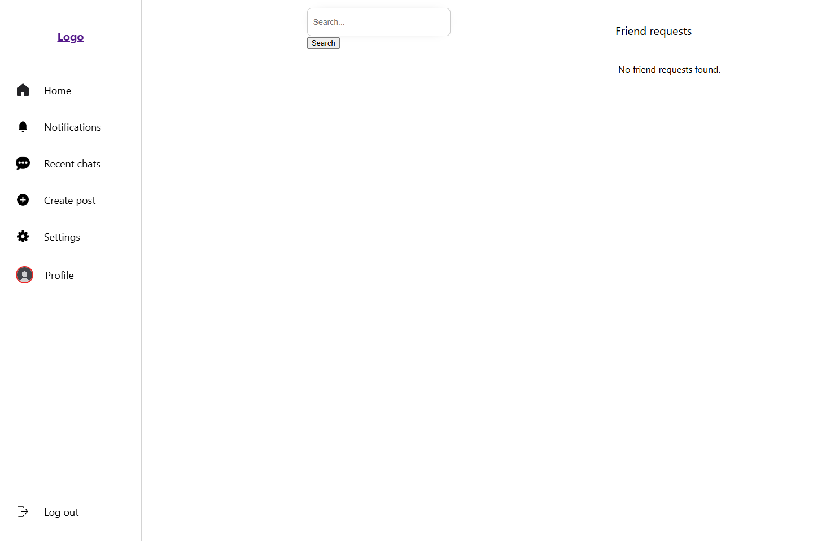 | 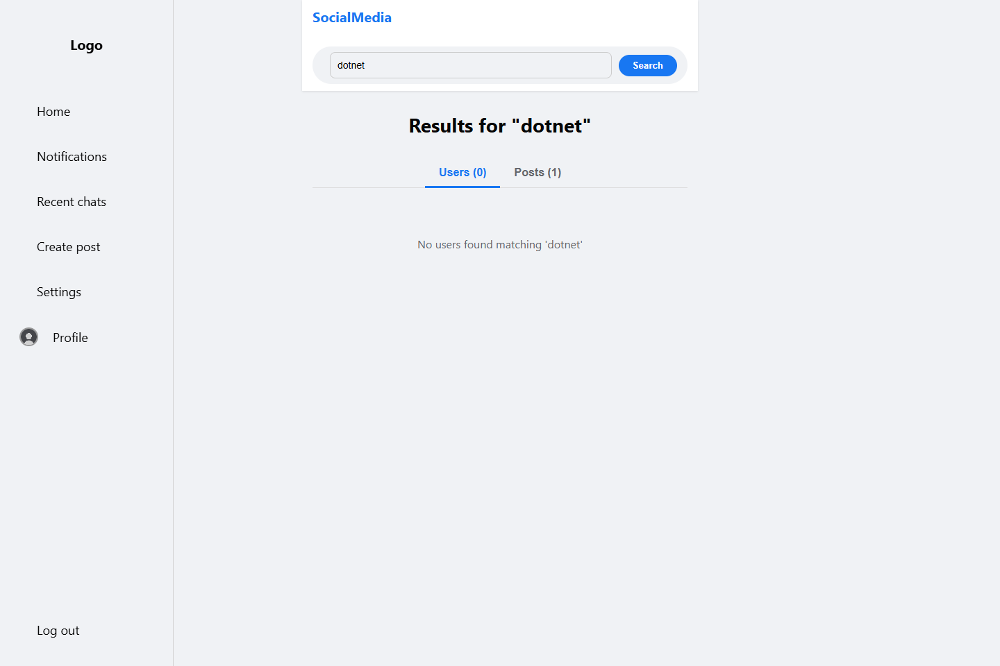 |

| Search — people | Notifications |
| --- | --- |
| 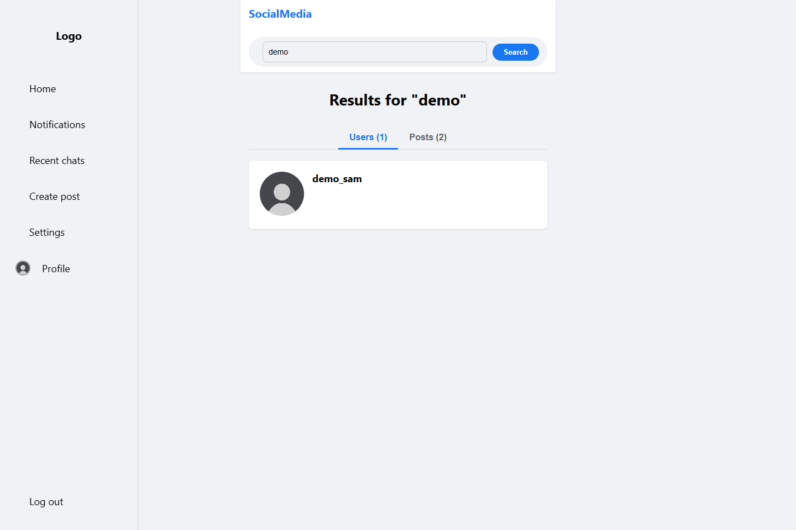 | 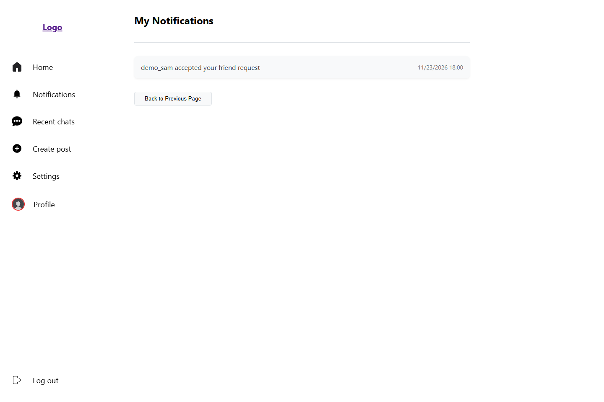 |

### Live chat

| Recent conversations | Encrypted chat thread |
| --- | --- |
| 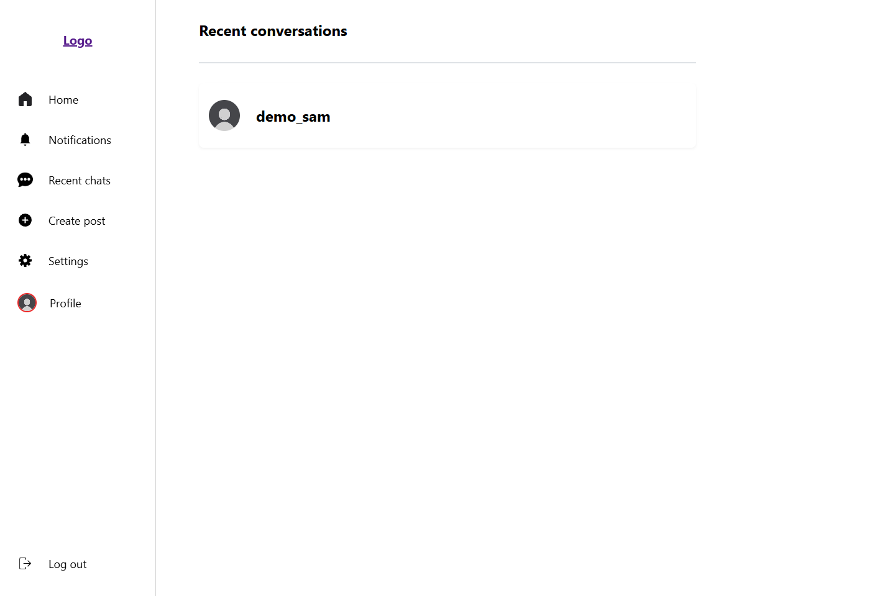 | 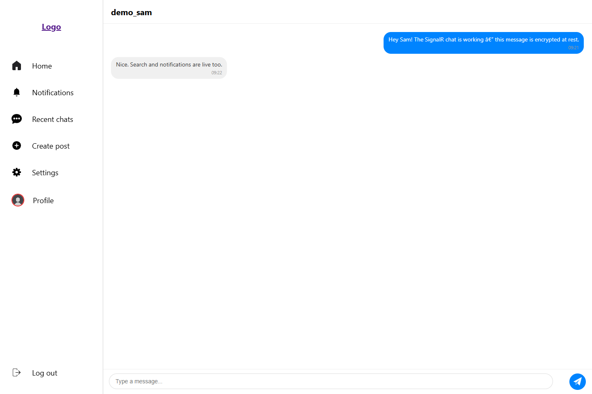 |

Messages are encrypted in the database and decrypted on load — the chat above is rendered from stored ciphertext.

### Posts and accounts

| Profile | Create post |
| --- | --- |
| 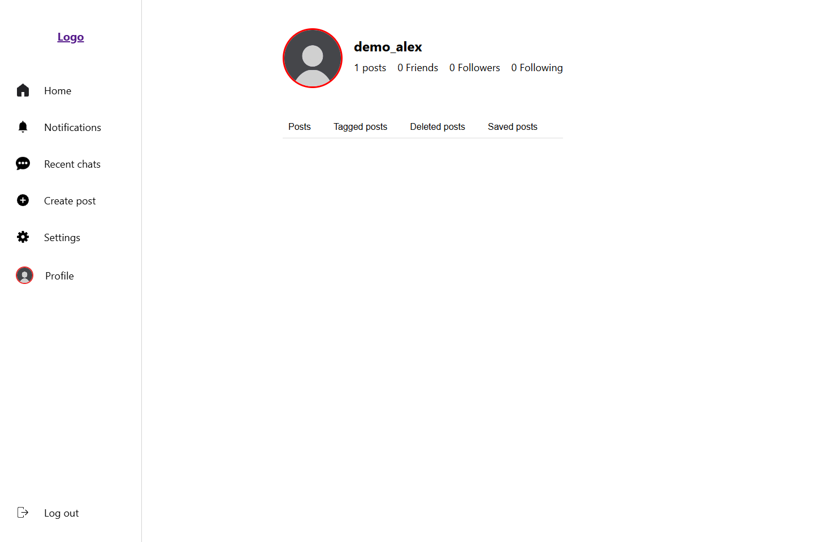 | 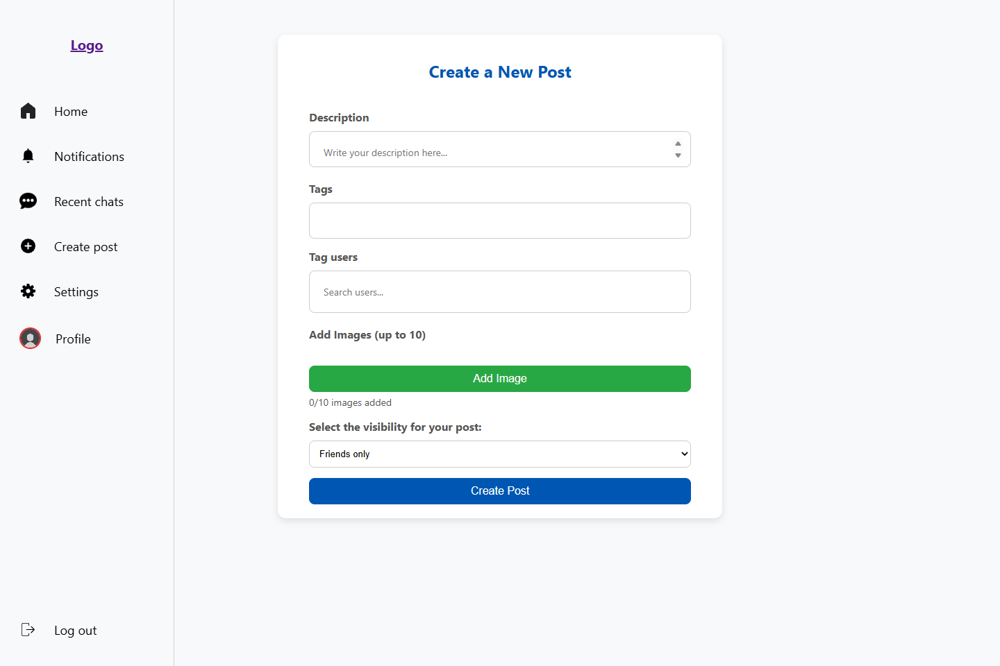 |

| Login | Register |
| --- | --- |
| 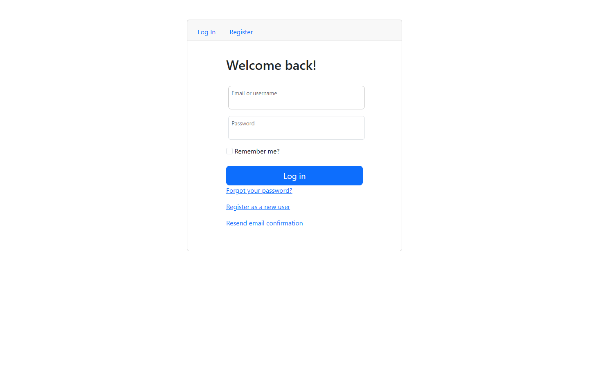 | 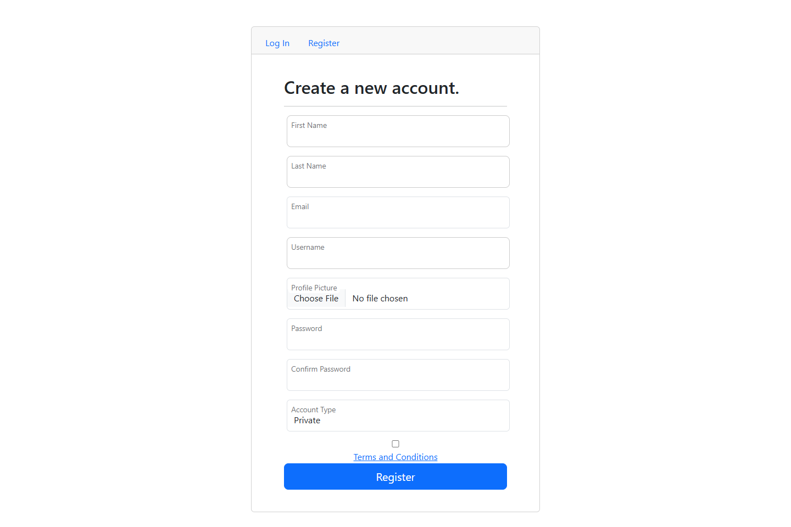 |

### Image posts

A post was created through the UI with a free Unsplash sea photo, uploaded to Cloudinary and shown in the feed and on the profile:

| Create post with image | Feed with the sea post | Profile posts tab |
| --- | --- | --- |
| 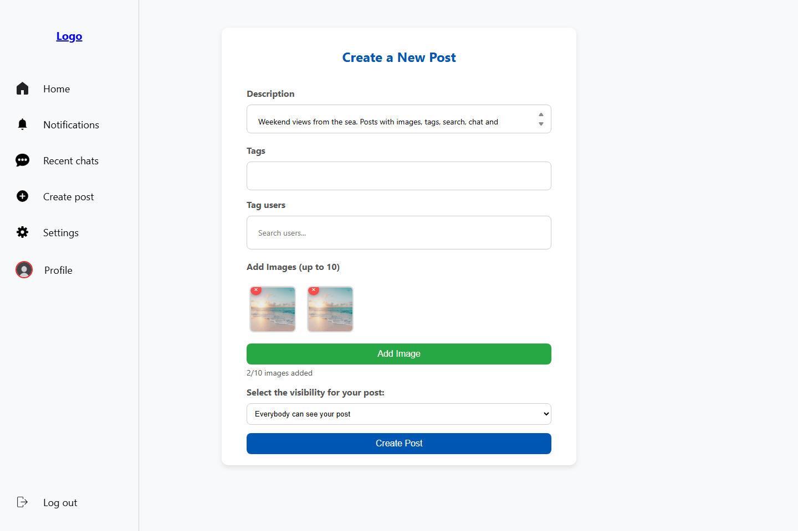 | 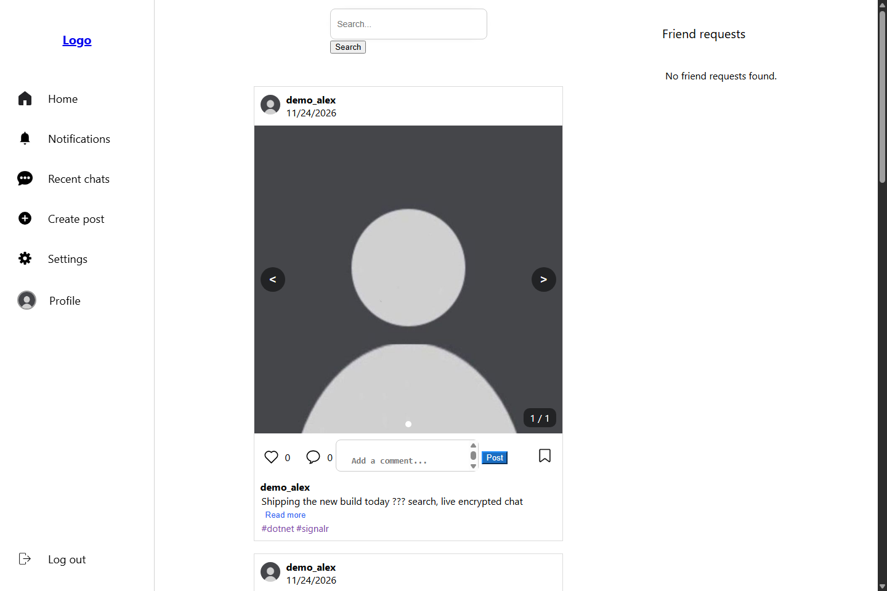 | 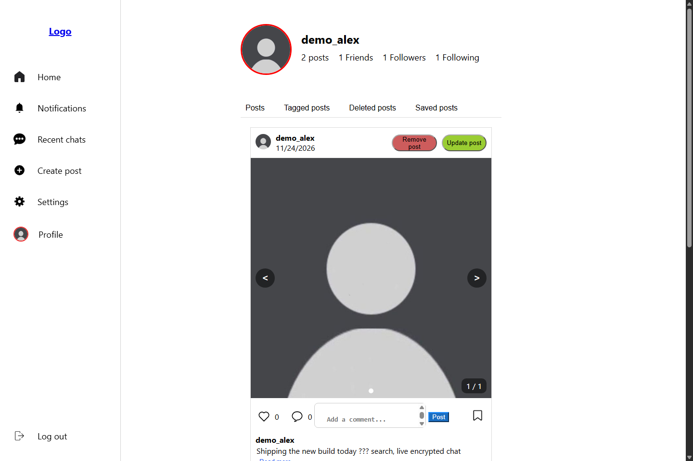 |

---

## Tech stack

| Layer | Technology |
| --- | --- |
| Web | ASP.NET Core 9 MVC + Razor Pages, Bootstrap 5, jQuery |
| Real-time | SignalR (`ChatHub`, `NotificationHub`) |
| Data | Entity Framework Core 9, Pomelo MySQL provider, 20+ migrations |
| Identity | ASP.NET Core Identity + roles |
| Storage | Cloudinary (image uploads) |
| Crypto | AES encryption service with per-message IV |
| Architecture | Multi-project solution: `Web`, `Service`, `Data`, `Models`, `Mappings` |

---

## Solution layout

```
SocialMedia.sln
├── Web/
│   ├── SocialMedia.Web/             # MVC app, controllers, views, SignalR client JS
│   │   ├── Controllers/             # Home, Post, Chat, Comment, Notification
│   │   ├── Areas/Identity/          # Login, Register, Manage, admin area
│   │   ├── Seed/                    # migrations-on-startup + roles
│   │   ├── Hubs (via Service)       # /chathub, /notificationHub
│   │   └── wwwroot/js/              # notification.js, site.js, imagesFunctions.js
│   └── SocialMedia.Web.Models/      # view models, custom tag model binder
├── Service/
│   ├── SocialMedia.Service/         # post, comment, reaction, friend, cloud, encryption, hubs
│   ├── SocialMedia.Service.Models/  # service-layer DTOs
│   └── SocialMedia.Service.Mappings/# AutoMapper-style entity ↔ service profiles
└── Data/
    ├── SocialMedia.Data/            # DbContext, repositories, 20+ EF migrations
    └── SocialMedia.Data.Models/     # entities (users, posts, tags, chats, notifications…)
```

---

## Code highlights

**Live chat with encryption and notification fan-out** — `Service/SocialMedia.Service/Hub/ChatHub.cs`:

```csharp
public async Task SendMessage(string toUserId, string plainText)
{
    var fromUserId = Context.UserIdentifier;
    using var scope = _serviceProvider.CreateScope();
    var encryptionService = scope.ServiceProvider.GetRequiredService<IEncryptionService>();

    var encrypted = encryptionService.Encrypt(plainText);
    await _chatRepository.SaveMessageAsync(fromUserId, toUserId,
        encrypted.EncryptedText, encrypted.IV);

    if (ConnectedUsers.TryGetValue(toUserId, out var connectionId))
        await Clients.Client(connectionId)
            .SendAsync("ReceiveMessage", fromUserId, plainText, ...);

    await Clients.Caller.SendAsync("ReceiveMessage", fromUserId, plainText, ...);

    await _notificationRepository.AddNotificationAsync(new Notification
    {
        UserId = toUserId,
        Message = $"{sender.UserName} sent you a message",
        CreatedAt = DateTime.UtcNow
    });
    await _serviceProvider.GetRequiredService<IHubContext<NotificationHub>>()
        .Clients.User(toUserId)
        .SendAsync("ReceiveNotification", notification.Message, ...);
}
```

**Ranked, visibility-aware search** — `Web/SocialMedia.Web/Controllers/HomeController.cs`:

```csharp
var posts = allPosts
    .Where(p => (p.Description != null && p.Description.ToLower().Contains(query)) ||
                (p.Tags != null && p.Tags.Any(t => t.Name.ToLower().Contains(query))) ||
                (p.CreatedBy.UserName != null && p.CreatedBy.UserName.ToLower().Contains(query)))
    .OrderByDescending(p => p.CreatedBy.UserName.ToLower() == query)
    .ThenByDescending(p => p.Tags.Any(t => t.Name.ToLower() == query))
    .ThenByDescending(p => p.Description.ToLower().Contains(query))
    .ThenByDescending(p => p.CreatedOn);
```

**Repository + service separation** — generic base repositories (`BaseGenericRepository`, `MetadataBaseGenericRepository`) are composed into feature services (`SocialMediaPostService`, `FriendRequestService`, `CommentService`, `ReactionService`) which controllers call. Mapping profiles keep EF entities out of the view models.

**Database bootstrap** — `Seed/DatabaseSeedUtilities.cs` applies pending EF migrations and seeds the `Administrator` and `User` roles at startup, so a fresh database comes up ready to use.

---

## Run it locally

Requirements: **.NET 9 SDK**, **MySQL 8+**.

1. Clone the repository:
   ```bash
   git clone https://github.com/kaloianI24/SocialMedia.git
   cd SocialMedia
   ```
2. Set configuration with environment variables (never commit real secrets):
   ```bash
   export ConnectionStrings__SocialMediaDbContextConnection="Server=localhost;Database=SocialMedia;User=root;Password=<your-password>;"
   export EncryptionKey="<a-32-character-random-key>"
   export Cloudinary__CloudName="<cloud-name>"
   export Cloudinary__ApiKey="<api-key>"
   export Cloudinary__ApiSecret="<api-secret>"
   ```
3. Restore and run:
   ```bash
   dotnet restore SocialMedia.sln
   dotnet run --project Web/SocialMedia.Web
   ```
4. Open `https://localhost:5001` and register an account. Migrations are applied automatically on first start.

### Docker

A multi-stage `Dockerfile` and `docker-compose.yml` are included in this repo:

```bash
docker compose up --build
```

That starts MySQL and the web app together on port `8090`.

---

## Deployment notes

- The app is **stateful**: it needs a persistent MySQL database and a long-running .NET host. It cannot be deployed as a static site.
- SignalR uses in-memory connection tracking (`ConcurrentDictionary`), so run **one web instance** or add a Redis backplane and sticky sessions before scaling out.
- Behind a reverse proxy, enable WebSocket forwarding for `/chathub` and `/notificationHub`.
- Set `ConnectionStrings__SocialMediaDbContextConnection`, `EncryptionKey` and the three `Cloudinary__*` values as platform environment variables / secrets.

> ⚠️ **Security:** older commits contain a database password, Cloudinary API secret and encryption key in `appsettings.json`. Treat those values as compromised: rotate them and move all configuration to environment variables before exposing the app publicly.

---

## Author

Kaloyan Miroslavov Ivanov — junior developer, Sofia, Bulgaria.
[GitHub](https://github.com/kaloianI24) · [LinkedIn](https://www.linkedin.com/in/kaloian-ivanov-36b644373/)
